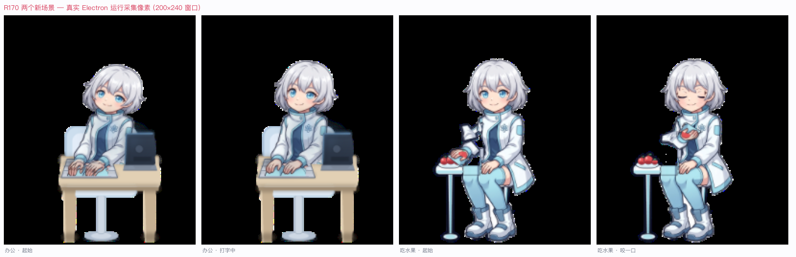

<div align="center">


# AI Desktop Companion · AI 桌宠

**A companion character that lives on your macOS desktop — it decides what to do next on its own**

Electron 33 · PixiJS v7 · Fully offline · Zero external APIs · 100% self-produced character art

[中文](README.md) · [MIT License](LICENSE) · [Docs](#-documentation)

</div>

---

## 📸 What it looks like

<table>
<tr>
<td></td>
</tr>
<tr>
<td align="center"><sub>Working at a desk · Eating fruit — captured from a live Electron run, 200×240 compact window</sub></td>
</tr>
</table>

## 🐾 What is this

A little character living on your macOS desktop.

It isn't a looping pre-rendered animation — it runs a **behavior engine** that decides what to do next based on its current state, mood, energy and the scene around it: get up and walk a bit, stand around idly, work at the computer, have a piece of fruit, get drowsy and lie down for a nap. Leave it alone and it still lives its own little life.

Interact with it and it responds: drag it anywhere on the desktop, click it for feedback, open the settings panel to adjust its temperament.

## ✨ Features

| | Capability | Details |
|---|---|---|
| 🎭 | **Autonomous behavior engine** | 12 states: `IDLE` / `WALK_LEFT` / `WALK_RIGHT` / `SLEEP_ENTER` / `SLEEP_LOOP` / `WAKE_UP` / `DRAGGING` / `GESTURE` / `SIT` / `DOZE` / `WORK` / `EAT_FRUIT`, with a transition probability table and interrupt/resume support |
| 💙 | **Mood system** | 4 moods (happy / calm / sleepy / bored) driven by interaction frequency and idle duration — and mood feeds back into behavior probabilities |
| 🪑 | **Scene props** | Desk / chair / sofa / bed / quilt / fruit table / keyboard / screen glow / moon / heart — 13 procedurally generated props |
| 🎬 | **23 playable actions** | 6 core actions (idle / walk_left / walk_right / sleep_enter / sleep_loop / wake_up) + 17 library actions (look around / tilt head / nod / stretch / happy / wave / clap / eat fruit …) |
| 🖱 | **Transparent interaction** | Transparent frameless always-on-top window with a precise hit region — pixels outside the character don't swallow mouse events |
| 🖱 | **Dragging** | 60Hz polling follow, handed back to the behavior engine on drop, clamped to the desktop bounds |
| ⚙️ | **Settings panel** | Scale / activity rate / sleep rate / click feedback / launch at login, persisted under `~/Library/Application Support` |
| 🚀 | **Desktop launcher** | One script generates a macOS `.app` bundle and drops it on your Desktop — double-click to launch |
| 🔒 | **Single instance** | Electron's native single-instance lock: launching again focuses the existing window instead of spawning a second pet |
| 🌍 | **Fully offline** | No server, no external API. All state stays on your machine |

## 🚀 Quick start

Requires **macOS 11+** and **Node.js 18+**.

```bash
# 1. Install dependencies (downloads the Electron runtime, ~200MB)
cd candidates/candidate_b_c2
npm install

# 2. Launch
npm start
```

The character appears in the top-left of your desktop in a compact 200×240 window.

### Install as a desktop icon (recommended)

```bash
# from the repository root
bash candidates/candidate_b_c2/113_R182_install_desktop_icon.sh
```

The script renders the character icon, packages a real `.app` bundle, places it on your Desktop, positions it in a **free grid slot that isn't covered by any open window**, verifies the position was actually persisted to disk, and smoke-tests the launch.

> The `AI桌宠.app` on your Desktop is a **copy** of the bundle in this repo; its `Contents/MacOS/AIPet` is a small delegate script that forwards to the repo's real launcher — so the startup logic exists in exactly one place.

## 📁 Repository layout

```
.
├── candidates/
│   ├── candidate_b_c2/            ← ★ main implementation: Electron + PixiJS
│   │   ├── src/                   ← runtime source (see table below)
│   │   ├── assets/                ← character frames + scene props + manifests
│   │   ├── tests/                 ← node unit tests
│   │   ├── 1xx_R182_*.py|sh       ← icon generation / desktop install / evidence scripts
│   │   └── evidence_r*/           ← reproducible evidence artifacts per round
│   ├── candidate_a_appkit/        ← alternative implementation: Objective-C + AppKit (kept for comparison)
│   └── candidate_b_electronpixir/ ← original candidate B (frozen, not on the mainline)
├── assets/prototype_chibi/        ← procedurally drawn placeholder character (early stage)
├── _app_bundle/                   ← packaged .app bundles
├── docs/                          ← per-round delivery indexes, QA reports and research
├── evidence/                      ← build logs / performance samples / screenshots
├── one_click_test/                ← one-click re-verification scripts
└── test_window/                   ← click-through probes and small tools
```

Core source files:

| File | Responsibility |
|---|---|
| `src/main.js` | Electron main process: window, drag IPC, single-instance lock, state persistence |
| `src/renderer.js` | PixiJS layer: sprite playback, scene prop mounting, click/drag handling |
| `src/behavior_engine.js` | The behavior state machine and scheduler (the biggest piece) |
| `src/mood_engine.js` | Mood scoring and decay |
| `src/action_library.js` | Action catalog, transition blending, gesture pool, click pool |
| `src/idle_director.js` | Fine-grained idle choreography (blinks, breathing) |
| `src/sprite_layout.js` | Character anchoring and layout math |
| `src/settings_store.js` / `settings_panel.*` | Settings persistence and the settings panel |

## 🧭 Tech selection (with the comparison kept in-repo)

The project ran a **frame-rate-fair comparison** between **Objective-C + AppKit** and **Electron + PixiJS**. Weighted score: **A 3.50 / B 3.55** (a 0.05/5.00 gap):

- AppKit is lighter (RSS ~27MB vs Chromium ~129MB), but was blocked by the local Swift toolchain, and abandoning the Electron work already invested would be a destructive migration;
- Electron is cross-platform, its npm ecosystem is the friendliest for adding AI later, and PixiJS's 2D sprite playback is exactly what this project needs.

The full reasoning, raw measurements and the rejected third route (Tauri) live in [`docs/R117_REQUIREMENTS_AND_OPEN_SOURCE_REVIEW.md`](docs/R117_REQUIREMENTS_AND_OPEN_SOURCE_REVIEW.md) and [`TECH_DECISION.md`](TECH_DECISION.md).

## 🎨 Character and art

**100% self-produced. This repository contains no third-party artwork.**

- Character: silver-white short hair, ice-blue eyes, white lab coat with cyan lining and cuffs, chibi ~2.5-head proportions
- All frame sequences, scene props and icons are generated procedurally by Python + Pillow baking scripts; the scripts and parameters are in the repo and fully reproducible
- `assets/prototype_chibi/LICENSE.txt` states it outright: *"Original deterministic test sprite graphics generated locally by Python/Pillow. No third-party artwork."*

> The character's final name and frozen appearance are still being settled; `default_scientist` is an internal development ID.

## ✅ Tests

```bash
# node unit tests (15 files)
cd candidates/candidate_b_c2 && node tests/*.test.js

# R147 end-to-end (real Electron, 60 assertions)
bash candidates/candidate_b_c2/R147_e2e_test.sh

# R177 runtime verification (real Electron, 34 assertions)
python3 candidates/candidate_b_c2/100_R177_runtime_verify.py
```

Current status: **unit tests 15/15 · e2e 60/60 · runtime verification 34/34**.

## 📚 Documentation

| Document | Contents |
|---|---|
| [`docs/01_PRD_v1.1_冻结基线.md`](docs/01_PRD_v1.1_冻结基线.md) | Product requirements baseline |
| [`docs/02_V0.0_技术验证任务书.md`](docs/02_V0.0_技术验证任务书.md) | Technical validation task book |
| [`docs/03_验收与审计规范.md`](docs/03_验收与审计规范.md) | Acceptance & audit spec |
| [`docs/04_角色资产与动画规范.md`](docs/04_角色资产与动画规范.md) | Character asset spec |
| [`TECH_DECISION.md`](TECH_DECISION.md) | Tech selection record (with measured performance data) |
| [`KNOWN_ISSUES.md`](KNOWN_ISSUES.md) | Known issues (including how TCC permissions limit real-machine acceptance) |
| [`CHANGELOG.md`](CHANGELOG.md) | Changelog |
| [`docs/R182_DELIVERY_INDEX.md`](docs/R182_DELIVERY_INDEX.md) | Most recent round (desktop launcher) delivery index |
| [`docs/`](docs/) | Every round has a DELIVERY_INDEX + QA_REPORT — the whole history is traceable |

## 🚧 Roadmap and honest limitations

Current boundaries, stated plainly:

- **V0.0 technical prototype, not a finished product.** Core engine, asset pipeline and desktop integration work; UI polish is still ahead.
- **Window-level transparency, not pixel-level click-through.** The current approach uses a compact 200×240 window plus hit-region avoidance; a true whole-window passthrough approach did not pass verification.
- **Real-machine visual acceptance is limited by TCC.** Automated processes don't get Screen Recording permission by default, so `screencapture` can't produce an image containing the pet's pixels. Verification therefore uses WindowServer window coordinates plus A/B pixel differencing — but the final look still needs a human eye.
- **Launch-at-login doesn't work from a source build** (macOS restricts login items for unsigned apps). The settings panel reports it honestly as off rather than pretending.
- **AI chat, long-term memory and voice are on the roadmap**, not implemented — this release is fully offline.

## 📄 License

Code and all artwork in this repository are released under the [MIT License](LICENSE).

Fork it and the character art is fair game too — because this repo generated it in the first place.

## 👤 Author

**墨良** ([moliangjin](https://github.com/moliangjin))

---

<div align="center">
<sub>Built with Electron + PixiJS — a small companion for your desktop · offline · no tracking</sub>
</div>
